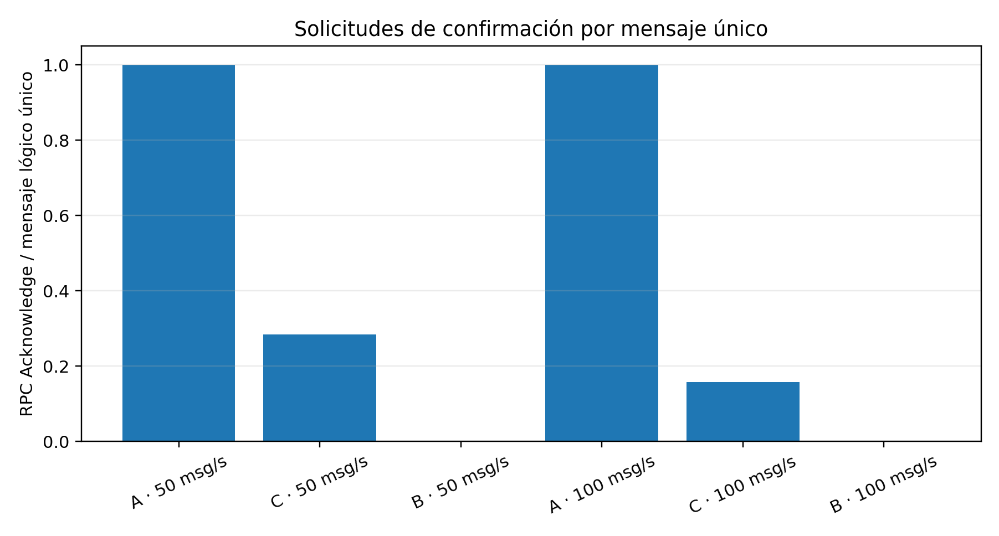
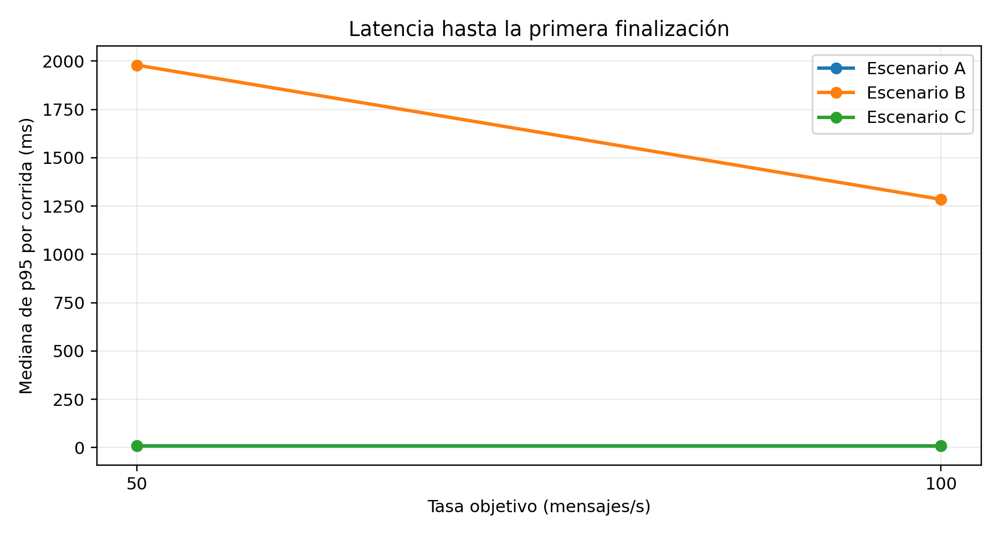
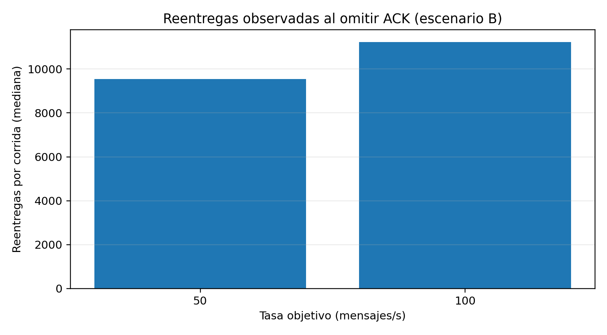

# Efecto de las políticas de confirmación sobre el overhead de ACK y la reentrega: evaluación experimental en el emulador de Google Cloud Pub/Sub

**Jorge Luis Coro**  
Escuela Superior Politécnica de Chimborazo — ESPOCH  
Facultad de Informática y Electrónica, Carrera de Telemática  
Asignatura: Sistemas Distribuidos y Paradigmas de la Computación · PAO 8

## Resumen

La confirmación de mensajes condiciona el comportamiento de los sistemas de mensajería con entrega *at-least-once*. En Google Cloud Pub/Sub, el consumidor puede confirmar individualmente cada mensaje o agrupar varios identificadores en una solicitud; si no confirma, el mensaje puede volver a entregarse al expirar el plazo de reconocimiento. Este trabajo examina experimentalmente cómo esas políticas se reflejan en el número de llamadas de confirmación y en métricas de latencia y reentrega. Se analizaron registros obtenidos con el emulador oficial local de Pub/Sub, bajo dos tasas objetivo (50 y 100 mensajes/s) y tres escenarios: ACK individual (A), ausencia de ACK (B) y ACK por lotes de hasta ocho identificadores o temporizador de 50 ms (C). El conjunto analizado reúne 37 corridas formales auditables: seis para A50, seis para A100, seis para B50, siete para B100, seis para C50 y seis para C100. La mediana del cociente RPC/mensaje único fue 1,000 en A y 0,285 y 0,158 en C para 50 y 100 mensajes/s, respectivamente. En B se observaron reentregas reiteradas y percentiles altos de latencia. Los hallazgos describen esta implementación y el emulador local; no constituyen una estimación del rendimiento del servicio administrado en producción.

**Palabras clave—** sistemas distribuidos, Google Cloud Pub/Sub, ACK, *at-least-once*, confirmación por lotes, reentrega, emulador.

## I. Introducción

Los intermediarios de mensajería desacoplan productores y consumidores, pero trasladan al diseño de la aplicación decisiones sobre confirmación, reintentos y tratamiento de duplicados. En un sistema distribuido, una entrega repetida no es necesariamente una anomalía: puede ser el resultado esperado cuando el consumidor no confirma dentro del plazo o cuando la confirmación no llega a producir el efecto esperado. La literatura sobre colas y procesamiento distribuido muestra que las garantías de entrega deben analizarse junto con el comportamiento del consumidor y la semántica de sus operaciones, no como una propiedad aislada del transporte [@john2017survey; @hesse2020kafka].

Google Cloud Pub/Sub utiliza por defecto una modalidad de entrega *at-least-once*. La documentación del servicio advierte que un mensaje no confirmado puede ser entregado nuevamente y que, incluso después de una respuesta satisfactoria a una solicitud de ACK, pueden producirse reentregas en determinadas circunstancias [@gcp_subscription; @gcp_architecture]. Por tanto, la confirmación reduce la probabilidad de repetición, pero no equivale a una transacción de negocio ni garantiza por sí sola que los efectos de la aplicación sean exactamente una vez.

Una optimización habitual consiste en agrupar identificadores de mensajes en una sola solicitud `Acknowledge`. La interfaz admite múltiples `ack_ids` en una llamada, de modo que el consumidor puede amortizar el coste de invocar la operación [@gcp_acknowledge]. Sin embargo, el agrupamiento introduce una decisión temporal: esperar a reunir más identificadores puede reducir el número de RPC, pero también prolongar el tiempo entre el fin del procesamiento y el envío de la confirmación. Esta compensación debe medirse en el contexto concreto de la implementación.

Los estudios de rendimiento de brokers y sistemas de procesamiento de eventos aportan métodos para comparar rendimiento, latencia y garantías, aunque sus cifras no pueden trasladarse directamente a Pub/Sub ni a otra configuración experimental [@john2017survey; @hesse2020kafka; @kreps2011kafka]. En consecuencia, el presente estudio se concentra en una comparación controlada de políticas de ACK sobre el emulador oficial local, evitando extrapolar los resultados a un servicio administrado.

## II. Objetivos

**Objetivo general.** Analizar experimentalmente el overhead de las confirmaciones de entrega y el comportamiento de reentrega asociado a la semántica *at-least-once* en Google Cloud Pub/Sub, mediante la comparación de políticas de ACK individual, ACK por lotes y ausencia de confirmación en un entorno de emulación local.

**Objetivos específicos.**

1. Cuantificar la relación entre solicitudes RPC de ACK y mensajes lógicos únicos recibidos al utilizar confirmación individual y agrupada bajo dos tasas de publicación.
2. Comparar la latencia hasta la primera finalización y describir el efecto de la política de confirmación sobre el comportamiento temporal observado.
3. Caracterizar las reentregas producidas al omitir ACK durante una ventana de observación finita, identificando sus implicaciones para el procesamiento *at-least-once*.

## III. Fundamento conceptual

### A. Confirmación y entrega *at-least-once*

En Pub/Sub, el consumidor confirma los identificadores recibidos mediante `Acknowledge`. Cuando el mensaje no se confirma dentro del plazo, puede volver a estar disponible para entrega. `ModifyAckDeadline` permite modificar ese plazo; establecerlo en cero solicita la redelivery inmediata y no debe confundirse con simplemente omitir ACK [@gcp_acknowledge; @gcp_lease]. En este estudio, el escenario B representa ausencia de `Acknowledge` y de `ModifyAckDeadline`, no un modo independiente del producto denominado *unconfirmed delivery*.

La semántica *at-least-once* obliga a que el consumidor tolere duplicados. En términos de diseño, esto suele requerir operaciones idempotentes o mecanismos de deduplicación a nivel de aplicación. La confirmación de transporte no demuestra que una operación externa —por ejemplo, una escritura en una base de datos— se haya completado de forma atómica con el ACK [@gcp_subscription; @gcp_architecture].

### B. Confirmación agrupada

La API permite incluir varios `ack_ids` en una solicitud. La agrupación reduce potencialmente las llamadas por mensaje, pero no elimina el coste: cambia su distribución y añade espera mientras se forma el lote. En este experimento, el escenario C agrupa hasta ocho identificadores o envía el lote cuando el identificador pendiente más antiguo alcanza el umbral de 50 ms. El umbral es una condición de disparo del cliente, no una garantía de que la RPC se ejecute exactamente a los 50 ms.

## IV. Metodología

### A. Diseño experimental

Se utilizó un diseño comparativo con tres escenarios. A confirma cada mensaje mediante una llamada con un único `ack_id`; B no envía ACK ni modifica el plazo; C agrupa hasta ocho identificadores o realiza *flush* al alcanzar 50 ms. Se consideraron tasas objetivo de 50 y 100 mensajes/s. La configuración experimental documentada contempló mensajes de 4 KiB, trabajo de procesamiento de aproximadamente 5 ms y plazo de reconocimiento de 10 s. El consumo se implementó mediante operaciones `Pull` de tipo unary, por lo que los resultados no se generalizan a `StreamingPull`.

El protocolo contempló inicialmente 60 corridas, organizadas en diez bloques por cada tasa de publicación. Durante la ejecución local se presentó una incidencia en el proceso de campaña: el proceso permaneció activo en el equipo, pero no se obtuvo una señal de cierre ni un estado final que permitiera confirmar de manera inequívoca la culminación de las ejecuciones restantes. Por esta razón, no fue posible determinar con suficiente certeza si esas ejecuciones habían concluido ni validar sus resultados. La auditoría de eventos y los registros conservados desde el inicio permitieron recuperar y verificar 37 corridas con información utilizable. La distribución del conjunto analizado fue A50=6, A100=6, B50=6, B100=7, C50=6 y C100=6. Las ejecuciones sin evidencia completa y verificable se excluyeron; no se reconstruyeron resultados a partir de estados ambiguos ni se reemplazaron con datos sintéticos. Esta decisión priorizó la trazabilidad y la integridad del conjunto analítico, aunque redujo el número de réplicas respecto del diseño inicial. La causa técnica exacta por la que el proceso no presentó un cierre concluyente no pudo establecerse con los registros disponibles, por lo que no se atribuye el incidente a un fallo específico de Python, del emulador o del sistema operativo.

### B. Entorno y procedencia de los datos

Las mediciones proceden del emulador oficial local de Google Cloud Pub/Sub, ejecutado en el equipo del investigador. El emulador facilita pruebas funcionales sin crear recursos administrados ni generar cargos de servicio, pero no reproduce necesariamente la infraestructura distribuida, las condiciones de red ni las características de rendimiento de producción [@gcp_emulator]. Por ello, el objeto de inferencia es la política del cliente bajo el entorno emulado.

El archivo analizado contiene 241 360 registros y 28 campos, con identificadores de corrida, escenario, tasa objetivo, aplicación, mensaje, entrega, marcas temporales, solicitudes ACK, estado y tamaño del payload. La unidad lógica de análisis es `app_id`; las entregas repetidas se conservan como eventos distintos. Para las estadísticas de latencia se tomó la primera finalización registrada por identificador lógico, calculando la diferencia respecto del instante monotónico de intento de publicación.

### C. Variables y métricas

El overhead primario se definió como el número de RPC de ACK dividido para el número de mensajes lógicos únicos observados en la corrida. Un valor cercano a uno representa una llamada por mensaje; valores menores indican que una solicitud incluyó, en promedio, varios identificadores. Para B, el valor cero significa que no se enviaron solicitudes ACK; no debe interpretarse como eficiencia de confirmación.

La latencia se calculó desde el intento de publicación hasta la primera finalización del procesamiento. Para cada corrida se obtuvieron mediana y percentil 95 (p95); posteriormente se resumieron las corridas mediante la mediana de sus estadísticos. Las reentregas se contabilizaron a partir del indicador de redelivery de los registros. Esta operacionalización permite describir la ventana observada, pero los percentiles calculados sobre mensajes completados no representan los mensajes censurados al cierre.

### D. Estrategia de análisis

Se presentan estadísticas descriptivas por escenario y tasa. La comparación principal es A frente a C, ya que ambos confirman los mensajes y difieren en la política de agrupación. B se trata descriptivamente: al omitir confirmaciones, las reentregas incrementan el número de entregas y modifican la carga de procesamiento, por lo que no constituye un control aislado del coste de ACK. El diseño metodológico contemplaba contrastes pareados por bloque y pruebas exactas de signos con ajuste de Holm; sin embargo, el conjunto recuperado no contiene diez bloques completos por condición. En esta versión no se atribuye significancia estadística a comparaciones incompletas ni se presentan valores p no sustentados por pares completos.

## V. Resultados

### A. Cobertura del conjunto

La campaña se diseñó para 60 corridas. Sin embargo, la incidencia del proceso de ejecución y la ausencia de un cierre verificable para las ejecuciones restantes limitaron el conjunto final a 37 corridas auditables. La distribución —siete corridas en B100 y seis en cada una de las demás condiciones— debe tenerse presente al interpretar las medianas. Los valores de mensajes únicos por corrida fueron consistentes con el volumen de publicación observado en A y C: mediana de 2 250 para 50 mensajes/s y 4 500 para 100 mensajes/s. En B, la mediana fue 1 888 mensajes únicos por corrida en ambas tasas, junto con un volumen mayor de entregas por la repetición de mensajes.

### B. Overhead de confirmación

La mediana de RPC ACK por mensaje único fue 1,000 en el escenario A para ambas tasas. En C descendió a 0,285 para 50 mensajes/s y 0,158 para 100 mensajes/s. En términos descriptivos, la política agrupada registró aproximadamente 71,5 % y 84,2 % menos RPC por mensaje único que la confirmación individual, respectivamente. Esta reducción corresponde a las llamadas observadas en el cliente y no equivale a una reducción del mismo porcentaje en bytes de red, latencia total o coste facturado.

*Figura 1. Mediana por corrida del cociente RPC ACK/mensaje lógico único. B se muestra como cero porque no envía ACK; este valor no representa eficiencia de confirmación, sino ausencia de solicitudes.*

### C. Latencia hasta la primera finalización

En A y C, las medianas por corrida de p95 se mantuvieron próximas: entre 8,60 y 8,68 ms en A y entre 8,62 y 8,67 ms en C. La proximidad observada sugiere que, en este entorno y con esta definición de latencia, el agrupamiento no produjo un cambio descriptivo importante en la primera finalización del procesamiento. Esta métrica termina cuando concluye el procesamiento y, por tanto, no incorpora directamente la espera posterior hasta el envío del ACK. La espera por identificador debe analizarse como una variable distinta.

En B, el p95 mediano fue considerablemente mayor: aproximadamente 1 979,29 ms a 50 mensajes/s y 1 284,79 ms a 100 mensajes/s. La dispersión es coherente con la presencia de reentregas y con el hecho de que la métrica selecciona la primera finalización lógica dentro de una secuencia de entregas. No se interpreta como una degradación causada por el ACK agrupado, puesto que B representa una política diferente.

*Figura 2. Mediana de los p95 calculados por corrida para la latencia hasta la primera finalización. Los resultados de B reflejan un régimen de reentrega distinto.*

### D. Reentregas al omitir ACK

En los escenarios A y C no se registraron reentregas en el conjunto analizado. En B, la suma de indicadores de reentrega fue 57 250 para las seis corridas de 50 mensajes/s y 78 526 para las siete corridas de 100 mensajes/s. La mediana por corrida fue 9 537,5 y 11 226 reentregas, respectivamente. Estas cifras muestran que la omisión de ACK no suprime el trabajo de confirmación sin consecuencias: los mensajes permanecen pendientes y pueden volver a entregarse, generando ejecuciones repetidas del procesamiento.

*Figura 3. Mediana de reentregas por corrida en B. La cifra representa eventos de entrega marcados como repetidos durante la ventana, no mensajes lógicos únicos.*

### E. Resumen comparativo

| Escenario | Tasa (msg/s) | Corridas | Mensajes únicos, mediana | RPC/único, mediana | Latencia p50 (ms) | Latencia p95 (ms) | Reentregas, mediana |
|---|---:|---:|---:|---:|---:|---:|---:|
| A | 50 | 6 | 2,250 | 1.000 | 7.29 | 8.60 | 0 |
| B | 50 | 6 | 1,888 | 0.000 | 12.16 | 1979.29 | 9,537 |
| C | 50 | 6 | 2,250 | 0.285 | 7.35 | 8.67 | 0 |
| A | 100 | 6 | 4,500 | 1.000 | 7.28 | 8.68 | 0 |
| B | 100 | 7 | 1,888 | 0.000 | 8.55 | 1284.79 | 11,226 |
| C | 100 | 6 | 4,500 | 0.158 | 7.31 | 8.62 | 0 |

*Tabla I. Resumen descriptivo calculado a partir de los registros recuperados. Las latencias corresponden a la primera finalización por `app_id`; las medianas se calculan primero por corrida y luego entre corridas.*

## VI. Discusión

Los resultados respaldan, en el entorno evaluado, la utilidad del agrupamiento para reducir la frecuencia de solicitudes ACK. El cociente RPC/mensaje único disminuyó de 1,000 en A a 0,285 y 0,158 en C. Esta diferencia es coherente con la posibilidad que ofrece la API de incluir múltiples identificadores en una misma solicitud [@gcp_acknowledge]. No obstante, el cociente no debe confundirse con una medida integral de eficiencia: no cuantifica por sí solo bytes transmitidos, uso de CPU, coste monetario ni tiempo de confirmación efectivo.

La estabilidad descriptiva de la latencia de primera finalización entre A y C también requiere una lectura cuidadosa. Como el procesamiento y el envío de ACK son etapas distintas, una política de agrupación puede incrementar la espera de confirmación sin alterar la marca temporal de finalización del trabajo. Por ello, una evaluación completa debe incluir la espera ACK por identificador, la duración de las RPC, los identificadores pendientes al cierre y los mensajes censurados. El presente resumen no permite concluir equivalencia entre políticas ni descartar colas de espera en los casos no completados.

El escenario B ilustra el coste operativo de omitir ACK en un sistema *at-least-once*. La repetición de entregas aumenta el trabajo ejecutado y modifica la distribución temporal de las finalizaciones. Este resultado es consistente con la semántica documentada de Pub/Sub: si el consumidor no confirma dentro del plazo, el mensaje puede volver a estar disponible [@gcp_subscription; @gcp_lease]. En consecuencia, “no enviar ACK” no debe presentarse como una variante de bajo overhead equivalente a confirmar eficientemente; es una condición que desplaza el coste hacia reentregas y reprocesamiento.

La comparación tiene límites importantes. Primero, la incidencia ocurrida durante la ejecución local impidió verificar el cierre de la campaña completa. Aunque el protocolo contemplaba 60 corridas, solo 37 contaron con registros auditables suficientes para incorporarse al análisis. Esta reducción limita la cobertura del diseño y aconseja interpretar los resultados como evidencia descriptiva del entorno evaluado. Segundo, las mediciones proceden de un emulador local. Aunque el emulador reproduce interfaces útiles para desarrollar y probar aplicaciones, no representa por sí mismo la infraestructura administrada ni sus condiciones de red y escalamiento [@gcp_emulator]. Tercero, el análisis de latencia utiliza la primera finalización observada y no incorpora los casos censurados en los percentiles reportados. Finalmente, las condiciones de `Pull` unary no deben generalizarse a `StreamingPull` ni a otras bibliotecas con renovación automática de plazos.

## VII. Conclusiones

1. **Respecto del objetivo específico 1**, la confirmación agrupada redujo descriptivamente el número de RPC ACK por mensaje único frente a la confirmación individual. La mediana pasó de 1,000 en A a 0,285 en C a 50 mensajes/s y a 0,158 en C a 100 mensajes/s. El resultado muestra descriptivamente una reducción de llamadas en el cliente evaluado, no una reducción equivalente del tráfico total o del coste del servicio.

2. **Respecto del objetivo específico 2**, las medianas de p95 de latencia hasta la primera finalización fueron similares entre A y C: aproximadamente 8,6 ms en las dos tasas. Esta métrica no incluye la espera entre el fin del procesamiento y el envío del ACK; por tanto, no permite afirmar que ambas políticas tengan igual latencia de confirmación. En B, los p95 fueron mucho mayores, dentro de un régimen afectado por reentregas.

3. **Respecto del objetivo específico 3**, la ausencia de ACK produjo reentregas reiteradas durante la ventana observada: la mediana por corrida fue de 9 537,5 eventos a 50 mensajes/s y 11 226 a 100 mensajes/s. En las condiciones observadas, omitir la confirmación no eliminó el trabajo asociado a los mensajes: dio lugar a entregas repetidas y a nuevas ejecuciones del procesamiento.

4. En relación con el objetivo general, el experimento ofrece una caracterización acotada del efecto de las políticas de ACK en el emulador oficial local: el agrupamiento reduce llamadas de confirmación por mensaje único, mientras que la omisión de ACK activa un patrón de reentrega. Debido a la cobertura parcial de corridas y al entorno emulado, los resultados deben considerarse evidencia experimental local y no una caracterización del rendimiento de Pub/Sub en producción.

## VIII. Recomendaciones

1. **Para optimizar el overhead de ACK**, evaluar la confirmación agrupada cuando el patrón de carga permita formar lotes, ajustando conjuntamente el tamaño máximo y el temporizador. La decisión debe basarse no solo en RPC por mensaje, sino también en la espera ACK por identificador, RPC pendientes y latencia extremo a extremo.

2. **Para evaluar el comportamiento temporal**, instrumentar por separado el instante de fin de procesamiento, envío del ACK y retorno de la RPC. Reportar p50 y p95 con el número de mensajes completados, pendientes y censurados, evitando interpretar la latencia de procesamiento como latencia de confirmación.

3. **Para gestionar la semántica *at-least-once***, diseñar consumidores idempotentes y mantener trazabilidad por identificador lógico. La aplicación debe tolerar entregas repetidas y no asumir que la confirmación de transporte garantiza una única ejecución de negocio.

4. **Para fortalecer la validez experimental**, completar los bloques faltantes con el mismo protocolo, conservar orden aleatorio y controles, y ejecutar posteriormente una campaña separada en Pub/Sub administrado con recursos y permisos autorizados. Los resultados de producción deberán analizarse como una fase independiente, sin mezclar sus datos con los del emulador.

5. **Para una versión publicable**, incorporar el análisis pareado por bloque cuando se disponga de réplicas completas, incluir intervalos de incertidumbre y publicar el código, los datos agregados, las definiciones de métricas y las instrucciones de reproducción. La versión final deberá indicar claramente la procedencia local de los registros y las limitaciones del tamaño muestral.

# Referencias

::: {#refs}
:::
